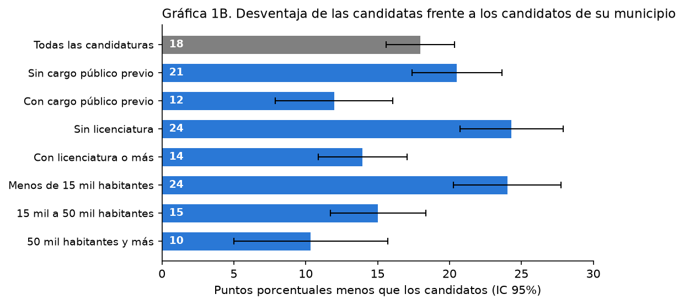

# Mujeres en las alcaldías de Veracruz

¿Por qué, aunque la mitad de las candidaturas a presidencias municipales en Veracruz son mujeres, ellas reciben menos votos y ganan menos alcaldías?

## Hallazgos principales

En 2025, las mujeres ganaron 54 de las 212 presidencias municipales. La brecha promedio fue de 18 puntos frente a candidatos de la misma elección y partido y de 16 puntos al comparar perfiles equivalentes; también varía según experiencia, escolaridad y tamaño del municipio.

[Documento completo](docs/Mujeres_alcaldias_Veracruz_AlejandroMunoz.md)

## Fuentes de datos

[INE](https://ine.mx/), [OPLE Veracruz](https://www.oplever.org.mx/) y [Censo de Población y Vivienda 2020 de INEGI](https://www.inegi.org.mx/programas/ccpv/2020/). Los CSV incluidos contienen los insumos procesados.

## Límites de los datos

Las comparaciones describen diferencias observadas y no identifican por sí solas sus causas. El apellido compartido con una autoridad saliente no demuestra parentesco, y algunas cifras del documento provienen de fuentes externas en lugar de los CSV reproducibles.

## Código

[Notebook](Anexo_metodologico_Veracruz_2025.ipynb)
Los datos están incluidos; el notebook corre con las dependencias fijadas en `requirements.txt`.
`python -m nbconvert --to notebook --execute --inplace --ExecutePreprocessor.timeout=1800 Anexo_metodologico_Veracruz_2025.ipynb`
