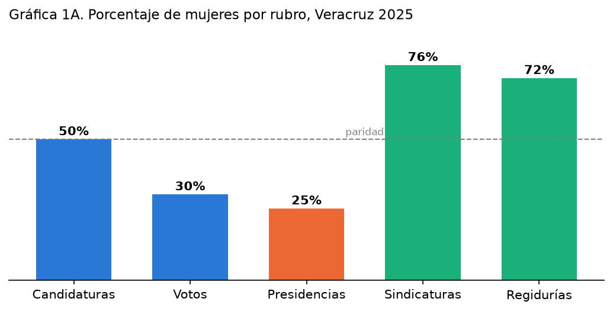
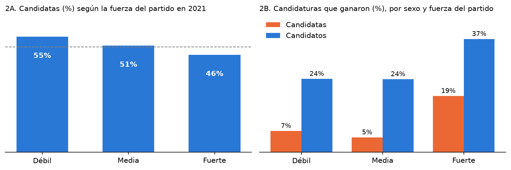

**Persiste la minoría de mujeres electas en las presidencias municipales**

Análisis de las candidaturas a las alcaldías de Veracruz en 2025

Alejandro Muñoz Fernández

- La mitad de las candidaturas a presidencia municipal en las elecciones de 2025[^1] fueron mujeres; sin embargo, recibieron 30 por ciento de los votos y ganaron 54 de las 212 presidencias, una de cada cuatro, igual que en 2021.

- **Frente a los candidatos hombres de su misma elección, una candidata obtuvo en promedio 18 puntos porcentuales menos.** Al compararla con un candidato de perfil equivalente (en edad, escolaridad, experiencia, presencia en redes y fuerza previa de su partido, entre otros rasgos), la diferencia sigue siendo de 16 puntos.

- **La brecha se reduce a casi la mitad cuando la candidata tiene licenciatura** (de 24 a 14 puntos) o **experiencia en un cargo público** (de 21 a 12), y es más amplia en los municipios de menos de 15 mil habitantes, donde más se postula a mujeres.

**En las últimas dos elecciones ha persistido la baja proporción de presidencias municipales encabezadas por mujeres**

En promedio en los municipios, la candidatura de una mujer obtuvo 12% de los votos, mientras que un hombre obtuvo 26%. Las mujeres ganaron 54 alcaldías (25%), prácticamente **la misma proporción que en 2021** (24%). En cambio, en las diputaciones locales que se ganan por distrito (mayoría relativa) y no por municipio, las mujeres obtuvieron 40% de los escaños en 2021 y 53% en 2024,[^2] por lo que **el rezago es propio de la elección municipal**.

Donde las mujeres cuentan con mayor participación es en las sindicaturas y regidurías, pues ocupan 76 y 72 por ciento respectivamente (gráfica 1, panel A). En las sindicaturas, la razón es una regla electoral: en cada planilla, la presidencia y la sindicatura deben ser de sexos distintos,[^3] de modo que cada presidencia que gana un hombre lleva consigo una síndica. En las regidurías, que se reparten por listas de cada partido, pesó un criterio del OPLE para 2025 que indica que las listas debían empezar con el sexo contrario al de 2021 y, donde hay una sola regiduría, ésta debía ser para una mujer.[^4] Por ello, las regidurías de mujeres pasaron de 46 a 72 por ciento entre 2021 y 2025.

**Las brechas de género en votación persisten entre los tamaños de municipios y la preparación de las candidatas**

Al comparar solo candidaturas de la misma elección municipal (misma boleta, mismo electorado y mismo gobierno saliente), la brecha es, en promedio, de 18 puntos y aparece en todos los partidos;[^5] sin esa restricción, es de 14. Que la brecha aumente 4 puntos al hacer esta comparación indica que las mujeres no pierden solo porque se les postula en municipios donde a cualquier candidatura le va mal**: aun frente a sus rivales directos, obtienen menos votos.**

Entre las candidatas que nunca ocuparon un cargo público, la brecha respecto de los hombres es de 21 puntos; entre quienes sí, de 12. Por el lado de la educación, sin licenciatura es de 24 puntos, y con licenciatura, de 14 (gráfica 1, panel B). Ambas diferencias se mantienen independientemente del tamaño del municipio. Al estimar por género, haber ocupado un cargo público previo suma cerca de siete puntos a una candidata y no tiene efecto medible en un candidato. Por lo que **la experiencia en un cargo público pesa más para las candidatas**, pues acerca sus votos a los de un candidato.

<picture>
  <source media="(prefers-color-scheme: dark)" srcset="figuras/grafica_1A_participacion_dark.png">
  
</picture>

<picture>
  <source media="(prefers-color-scheme: dark)" srcset="figuras/grafica_1B_brechas_dark.png">
  
</picture>

Nota: las líneas al final de cada barra del panel B son intervalos de confianza de 95 por ciento; todas las brechas son estadísticamente significativas. Rangos de población con los cortes que INEGI usa para localidades. Fuente: elaboración propia con datos del INE y del OPLE Veracruz.

Las candidatas tienen diferencias con los hombres, pues son casi tres años más jóvenes, 30 por ciento declaró haber ocupado un cargo público contra 47 por ciento de los candidatos, y el triple de ellas presentó en Conóceles propuestas de campaña con texto repetido, idéntico o casi idéntico al de otras candidaturas de su partido (10% contra 3%), lo que sugiere que fueron llenadas con un formato del partido. Pero eso no explica la brecha: al comparar a una candidata con un candidato de perfil equivalente, incluido si redactó sus propuestas con texto propio o repetido,[^6] la diferencia solo baja de 18 a 16 puntos, por lo que **la desventaja no se debe a que las candidatas lleguen con menos preparación o experiencia**.

Tampoco la brecha la explica la relevancia de las propuestas de campaña, es decir, que atiendan una carencia en la que el municipio está entre los más rezagados del estado según el Censo 2020.[^7] **Las candidatas hicieron propuestas relevantes tan a menudo como sus rivales, pero hacerlas no les dio más votos**. De hecho, las propuestas casi no siguen las carencias locales: donde más viviendas carecen de agua o drenaje, sólo la mitad (48%) de las candidaturas de hombres y mujeres habló del tema; en los demás municipios, donde la carencia es menor, lo hizo 42%, casi la misma proporción.

**En qué tipo de municipios se postula a las mujeres**

Las mujeres son 58% de todas las candidaturas, sumando todos los partidos, en los municipios de menos de 15 mil habitantes, mientras que en los de 50 mil habitantes y más representan poco más de un tercio (36%). Y es justo en los municipios más pequeños donde la brecha de género en el voto es mayor: 24 puntos frente a sus rivales hombres, contra 15 en los de 15 mil a 50 mil habitantes y 10 en los de 50 mil y más. Además, **donde un partido ya gobernaba (fuera hombre o mujer el alcalde saliente), se postularon mujeres 9 puntos porcentuales menos que en municipios donde no gobernaba el partido**. Las candidaturas del partido que ya gobernaba ganaron 41 por ciento de las veces, contra 15 por ciento de las demás. En ese grupo, los hombres fueron 57% de las candidaturas (contra 49% en el resto) y 69% de quienes ganaron, por lo que **los partidos tienden a reservar para hombres las candidaturas con más probabilidades de ganar.**

Los partidos también postulan más mujeres en los municipios donde son más débiles. Para cada partido, se ordenaron los municipios según el porcentaje de votos que obtuvo en 2021 (hubiera ganado o no) y se dividieron en tres grupos iguales: fuerza débil, media y fuerte. Las mujeres fueron 55 por ciento de sus candidaturas donde el partido era más débil, 51 por ciento en fuerza media y 46 por ciento donde era más fuerte (gráfica 2, panel A). Sin embargo, esa colocación no alcanza para explicar la brecha: aun donde su partido era fuerte, solo 19 de cada 100 candidatas ganaron, contra 37 de cada 100 candidatos (gráfica 2, panel B).

<picture>
  <source media="(prefers-color-scheme: dark)" srcset="figuras/grafica_2_fuerza_partido_dark.png">
  
</picture>

Nota: la fuerza de cada partido es relativa a sus propios resultados: para cada partido, los municipios se dividen en tercios según el porcentaje de votos que obtuvo ahí en 2021. Por ejemplo, un municipio "fuerte" para Morena-PVEM es donde obtuvo más de 40 por ciento; para el PT, más de 3 por ciento. Es una aproximación a los bloques de competitividad del OPLE. Fuente: elaboración propia con datos del INE y del OPLE Veracruz.

**Conclusiones**

La paridad en Veracruz resolvió la postulación, pero no el resultado. Para evaluarla, **el indicador relevante no es cuántas mujeres integran el cabildo, sino cuántas lo encabezan**, y esa proporción no se movió entre 2021 y 2025. El rezago no es exclusivo del estado: en el país, las mujeres pasaron de 5 a 30 por ciento de las presidencias municipales electas entre 2010 y 2024, mientras en los congresos locales llegaron a 53 por ciento.[^8]

Thomas y Bodet (2013) atribuyen la subrepresentación a que los partidos postulan mujeres donde tienen pocas posibilidades de ganar.[^9] En Veracruz esa colocación existe y reduce cuántas alcaldesas puede haber, pero no explica que una candidata obtenga menos votos que sus rivales: aun frente a candidatos cuyo partido tenía la misma fuerza en el municipio, la brecha sigue en 16 puntos. Lo que sí la acota son la escolaridad y la experiencia, lo que apunta al tipo de candidatura que se registra.

Los datos apuntan a medidas que van más allá de postular mujeres en la mitad de las candidaturas. En 2025, el Comité CEDAW de la ONU recomendó a México establecer salvaguardas contra candidaturas simuladas o controladas por hombres vinculados a partidos o familias.[^10] Esto conecta con Mendoza Madrigal (2024), quien encontró que **41 por ciento de las alcaldesas veracruzanas del ciclo anterior tenía parentesco directo con exfuncionarios**, y con la reforma que desde 2030 prohíbe postular a familiares de integrantes del ayuntamiento.[^11] Además, los bloques de competitividad (la regla del OPLE que obliga a repartir candidatas entre municipios donde el partido es fuerte, medio y débil) **no consideran el tamaño del municipio ni si el partido ya gobierna**, y el piso de 50 por ciento del financiamiento y de los promocionales para candidatas se mide sobre el total de cada partido y no por municipio,[^12] por lo que **un partido puede cumplirlo concentrando recursos en pocas contiendas**.

[^1]: Incluye Tamiahua, cuya elección ordinaria fue anulada y se repitió el 29 de marzo de 2026; se usa el PREP de esa elección extraordinaria.

[^2]: Resultados de la elección de diputaciones locales de 2024: 16 de los 30 distritos ([<u>Diario de Xalapa</u>](https://www.diariodexalapa.com.mx/local/mujeres-obtienen-16-curules-para-el-congreso-de-veracruz-asi-quedara-conformado-12034114.html) y [<u>La Silla Rota</u>](https://lasillarota.com/veracruz/reportajes/2024/10/17/ellas-son-las-27-mujeres-que-integraran-el-proximo-congreso-de-veracruz-418046.html)).

[^3]: Artículo 16 del [<u>Código Electoral para el Estado de Veracruz</u>](https://www.te.gob.mx/sites/default/files/legislacion/veracruz/codigoelectoralveracruz.htm): las fórmulas de presidencia y sindicatura de cada planilla deben ser de géneros distintos. En 2025 se cumplió en 208 de los 211 ayuntamientos del proceso ordinario.

[^4]: Criterio anunciado por el OPLE ([<u>La Silla Rota, 13 de enero de 2025</u>](https://lasillarota.com/veracruz/estado/2025/1/13/habra-alternancia-de-genero-en-candidaturas-alcaldias-de-veracruz-esto-dijo-el-ople-518191.html)). En la integración oficial, el primer lugar de las listas de regidurías pasó de 43 a 91 por ciento de mujeres entre 2021 y 2025.

[^5]: Regresión lineal (mínimos cuadrados ordinarios) con efectos fijos de municipio (cada candidatura se compara con sus rivales) y de partido (se descuenta su votación promedio). Como los porcentajes de un municipio suman cien, se verificó también sin ese límite: 11.7 votos menos por cada cien electores y 25 puntos menos de probabilidad de ganar.

[^6]: Edad, escolaridad, autoadscripción indígena, experiencia declarada, redes, extensión y texto repetido de la ficha, votación del partido en 2021, si gobernaba, cargo en 2022-2025 y apellido compartido con el alcalde saliente (11.6 por ciento de las candidaturas, contra 3.5 esperable por azar; la coincidencia no prueba parentesco).

[^7]: Carencias del Censo 2020 por municipio: viviendas sin agua entubada o drenaje, población sin servicios de salud, analfabetismo, desocupación y población rural. Relevante: menciona el tema y el municipio está en el tercio más rezagado del estado. Efecto en el voto: 1.2 puntos (p = 0.41), sin diferencia por sexo ni con otros umbrales (ver anexo).

[^8]: INE, acuerdo INE/CG55/2025, con datos de INMUJERES para todo el país.

[^9]: Thomas, M. y Bodet, M. A. (2013), Electoral Studies 32(1); Mendoza Madrigal, M. (2024), TEPJF.

[^10]: CEDAW/C/MEX/CO/10, Observaciones finales sobre el décimo informe periódico de México, julio de 2025, párrafo 34.

[^11]: Reforma a la Constitución de Veracruz del 30 de junio de 2026, aplicable desde 2030: alcanza a cónyuges, concubinos y parientes de ediles en funciones.

[^12]: Lineamientos del INE contra la violencia política de género, art. 14, fr. XV, y acuerdo INE/CG55/2025 (verificación por partido y por cargo).
